<div align="center">
  
</div>

# Hi, I'm Parth 👋

Developer and technical writer from India. By day I write docs, deep-dive articles and video for an email platform, with some light coding on the side. The rest of the time I'm working my way into **DevOps and SRE**, one broken VM at a time.

- 🔭 Building an **email event pipeline** as my main DevOps portfolio project, growing it in three stages through the end of 2026
- 🌱 Learning AWS, Terraform, Kubernetes, Ansible and Docker; working toward AWS Cloud Practitioner, Terraform Associate and CKA
- 🎬 Making **Larping Linux**: I learn one Linux concept, break it in a VM, and turn it into a short narrated reel
- ✍️ Open to freelance technical writing and docs for dev tools and SaaS
- 💬 Ask me about DevOps, Linux, email infrastructure (SPF, DKIM, DMARC), Go and tech in general
- ⚡ Fun fact: I jailbroke my Kindle to run KOReader, and I still love to pet animals

## 🗺️ Roadmap

```text
parth@fedora:~$ cat roadmap.txt
[ building ]  email event pipeline      3 stages, Oct to Dec 2026
[ filming  ]  Larping Linux             ep 1: processes ✓   ep 2: Fedora Server install
[ studying ]  AWS Cloud Practitioner
[ queued   ]  Terraform Associate
[ queued   ]  CKA
[ target   ]  junior DevOps role, remote, 2027
```

## 🚀 Featured projects

| Project | What it is | Stack |
|---|---|---|
| 🚧 Email event pipeline | My DevOps portfolio project: an email event pipeline built and hardened in three stages | Work in progress |
| [imgup](https://github.com/tiwariParth/imgup) | Upscale images 4x with AI, locally on your own GPU. Tiled to run on 4 GB cards. | Python, PyTorch |
| [whosay](https://github.com/tiwariParth/whosay) | Lightweight system monitor for developers, right in the terminal | Go |
| [DevTyper](https://github.com/tiwariParth/DevTyper) | Practise typing while you wait for `npm install` or `docker build` to finish | Go |
| [StudySmartBuddy](https://github.com/tiwariParth/StudySmartBuddy) | AI study assistant: turns PDFs and notes into summaries and flashcards | TypeScript, Next.js |
| [UNO for Us](https://github.com/tiwariParth/uno-for-us) | Online multiplayer UNO for 2 to 5 players, with bots and real-time play | TypeScript |

## ✍️ Writing and work

- 📚 Write and maintain product docs and technical guides
- 🛡️ Hands-on with email infrastructure: SPF, DKIM and DMARC, including the new DMARCbis RFCs
- 🔍 Long-form technical articles, backed by Claude Code skills I built for automated fact-checking

## 💻 Tech stack

**Languages**<br>
       

**DevOps & cloud**<br>
        

**Frontend & backend**<br>
    

**Databases**<br>
    

**Tools**<br>
       

## 📊 GitHub activity


<picture>
  <source media="(prefers-color-scheme: dark)" srcset="https://raw.githubusercontent.com/tiwariParth/tiwariParth/output/github-snake-dark.svg">
  <source media="(prefers-color-scheme: light)" srcset="https://raw.githubusercontent.com/tiwariParth/tiwariParth/output/github-snake.svg">
  
</picture>

## 🌐 Find me

[](https://pt-portfolio-v2.vercel.app) [](https://linkedin.com/in/tiwariparth6165) [](https://x.com/Tiwariparth6165) [](https://instagram.com/parthtiwari6165) [](mailto:tiwariparth067@gmail.com)


